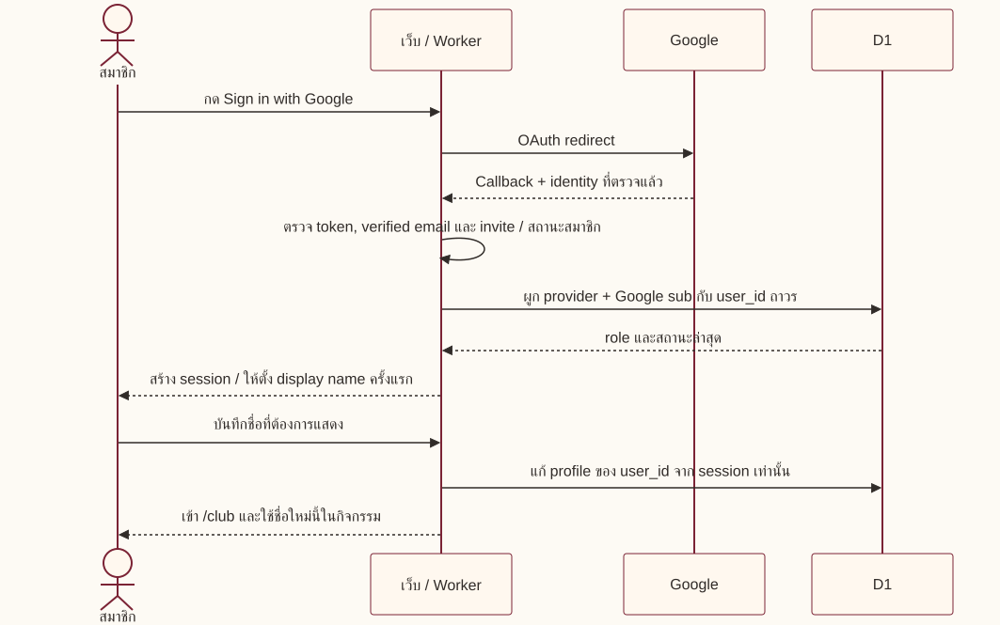

# แผนระบบสมาชิก สิทธิ์ และการโหวตของชมรม

สถานะ: **แผนสำหรับรีวิว ยังไม่ใช่ระบบที่เปิดใช้งาน** · ปรับปรุง 22 ตุลาคม 2026 · [PR #31](https://github.com/intaniadebate/intaniadebate/pull/31) · [Issue #30](https://github.com/intaniadebate/intaniadebate/issues/30)

เอกสารนี้เป็นแผนหลักฉบับปรับปรุง แทนข้อกำหนดและ pseudo-diff ใน HTML เดิมของ PR #31 ประวัติการเปรียบเทียบทางเลือกเดิมยังอ่านได้จาก Git history งาน PR นี้เปลี่ยนเฉพาะเอกสาร การนำแผนไปทำจริงให้แยก Issue/PR ตามระยะด้านล่าง

## 1. ผลลัพธ์ที่ต้องการและข้อตกลงแล้ว

- ใช้ **วิธี A: Astro + Cloudflare Workers + Better Auth + Cloudflare D1** เว็บไซต์สาธารณะยังเป็นหน้าที่สร้างล่วงหน้า ส่วนสมาชิกและ API ทำงานบนเซิร์ฟเวอร์ในโดเมนเดียวกัน
- สมาชิกล็อกอินด้วย Google ที่ได้รับเชิญ มีบัญชีแยกคน ตั้ง **ชื่อที่แสดงในเว็บ** ได้เอง ไม่ต้องตั้ง username/password ของเว็บ
- แบ่งสิทธิ์ `member`, `admin`, `owner` และตรวจสิทธิ์ที่เซิร์ฟเวอร์ทั้งหน้าเว็บและ API
- ต่อระบบโหวตได้โดยใช้รหัสสมาชิกเดิม: ผู้มีสิทธิ์แต่ละคนมี **แต้มรวมเท่ากันต่อรอบ** แล้วแบ่งให้ candidate; จำนวนแต้มเป็นค่าของรอบ ไม่ได้กำหนดตายตัวว่า 10 แต้ม
- สมาชิกเห็นผลรวมหลังปิดโหวต ส่วน admin/owner ดูบัตรลงคะแนนรายคนได้ ต้องบอกผู้โหวตก่อนส่งว่าระบบนี้ **ไม่ใช่การโหวตแบบนิรนาม**
- เปิดรับคะแนนตามเวลาเซิร์ฟเวอร์ที่กำหนด มีปุ่มให้ admin/owner หยุดก่อนกำหนด และ dashboard สรุปคะแนนหลังปิดรอบ

ปัจจุบันเว็บเป็น Astro แบบ static บน **GitHub Pages** และใช้ Cloudflare ดูแล DNS จึงต้องย้าย hosting ก่อนเพิ่มส่วนที่ทำงานบนเซิร์ฟเวอร์ การเลือกวิธี A เป็นทิศทางของแผน ไม่ได้หมายความว่าได้ย้ายแล้ว

## 2. แผนผังระบบ: อะไรทำหน้าที่อะไร

[Mermaid source](diagrams/member-auth-system.mmd)

**Better Auth เป็นไลบรารีในโค้ดเซิร์ฟเวอร์ของเรา** ไม่ใช่เว็บอีกแห่งที่ทีมต้องเข้าไปจัดการสมาชิก หน้า `/admin` ที่เราสร้างจะเป็นจุดจัดการผู้ใช้ โดยข้อมูลอยู่ใน D1 ของบัญชี Cloudflare ที่ชมรมกำหนด ส่วน Google รับผิดชอบการยืนยันบัญชีและรหัสผ่าน Google [Google provider](https://better-auth.com/docs/authentication/google), [Better Auth database](https://better-auth.com/docs/concepts/database)

| สิ่งที่เก็บ | เก็บที่ไหน | ใครเข้าถึง / หลักการ |
| --- | --- | --- |
| โค้ดเว็บ หน้า private ที่เป็น template และ SQL migration | GitHub repo เดียวกับเว็บ | ใช้ PR review; template ไม่ใส่ข้อมูลลับ แม้ repo เป็น public ก็ต้องไม่เปิดเผยข้อมูลสมาชิก |
| Google account ID, verified email, session และวันหมดอายุ | D1 ผ่าน Better Auth | Worker อ่านผ่าน binding; ไม่เปิดฐานข้อมูลให้ browser เรียกตรง |
| ชื่อแสดงผล, role, สถานะสมาชิก, invite | D1 | สมาชิกแก้ได้เฉพาะชื่อของตัวเอง; สิทธิ์และสถานะเปลี่ยนผ่านผู้ดูแลที่ได้รับอนุญาต |
| รายชื่อผู้มีสิทธิ์, candidate, บัตรคะแนน, ผลรวม, audit | D1 | API แยกสิทธิ์ข้อมูลรายคนกับผลรวม; ไม่อยู่ใน JSON public หรือ GitHub |
| Google password | Google | เว็บไม่รับหรือเก็บรหัสผ่าน Google; ลืมรหัสผ่านให้กู้บัญชีที่ Google |
| Auth secret / Google client secret | Cloudflare Worker Secrets | ไม่ใส่ใน source, `PUBLIC_*`, PR, log หรือ frontend bundle |
| ตัวระบุ session | Cookie ใน browser และข้อมูล session ใน D1 | ใช้ HttpOnly, Secure บน HTTPS และ SameSite ที่เหมาะกับ OAuth; ไม่เก็บ token ใน localStorage |
| รูป/วิดีโอที่ตั้งใจให้สาธารณะ | สื่อเดิม เช่น Cloudinary / static assets | ไม่ถือว่าเป็นที่เก็บไฟล์ส่วนตัว |
| ไฟล์ส่วนตัวในอนาคต | R2 bucket แบบ private | ไม่มี public URL ที่ข้ามสิทธิ์; Worker ตรวจสิทธิ์ก่อนอ่าน หรือออก URL อายุสั้นตามนโยบาย |

ไม่ต้องแยก repo เพื่อทำ login การแยก repo ไม่ได้แทนการป้องกันข้อมูลที่เซิร์ฟเวอร์ หากมีเนื้อหาที่ตัว source ต้องเป็นความลับ ให้ทีมตัดสินใจเรื่อง repo private แยกต่างหาก ข้อมูลจริงและ secrets ต้องออกจาก Git ทุกกรณี [Worker Secrets](https://developers.cloudflare.com/workers/configuration/secrets/), [R2 public access](https://developers.cloudflare.com/r2/buckets/public-buckets/)

## 3. เส้นทางล็อกอินและชื่อที่สมาชิกตั้งเอง

[Mermaid source](diagrams/member-auth-login.mmd)

1. Admin/owner เพิ่มอีเมลใน invite list เป็น `member` พร้อมวันหมดอายุและผู้เชิญ การสร้าง invite ไม่ส่งอีเมลอัตโนมัติในระยะแรก สมาชิกเข้าผ่านลิงก์ `/login` ที่ทีมแชร์ได้
2. Better Auth จัดการ OAuth และ session; โค้ดชมรมตรวจอีเมลที่ **ยืนยันแล้ว**, invite ที่ยังใช้ได้ และสถานะบัญชีก่อนให้สิทธิ์/สร้าง session สำหรับสมาชิกใหม่ ตรวจสมาชิกเดิมด้วยทุกครั้งที่เข้าใช้งาน
3. ใช้ `user_id` ภายในที่คงเดิม และผูก Google ด้วย `(provider, sub)` ไม่ใช้ชื่อหรือ email เป็น primary key; ไม่รวมบัญชีอัตโนมัติเพียงเพราะอีเมลเหมือนกัน การย้ายบัญชี Google ต้องเป็นกระบวนการตรวจสอบโดย owner และคง user_id เดิม [Google identity claims](https://developers.google.com/identity/openid-connect/openid-connect)
4. ให้ตั้งชื่อแสดงผลครั้งแรก; ชื่อเริ่มต้นจาก Google ใช้เป็นข้อเสนอให้แก้ ไม่เขียนทับชื่อที่สมาชิกเลือกเองเมื่อ login ครั้งต่อไป
5. ข้อเสนอสำหรับชื่อ: 2–50 ตัวอักษรที่ผู้ใช้อ่านเห็น รองรับไทย/อังกฤษ ตัดช่องว่างหัวท้าย ปฏิเสธชื่อว่าง/อักขระควบคุม และแสดงเป็นข้อความที่ escape แล้ว ชื่อซ้ำกันได้ จึงใช้รหัสสมาชิกแยกตัวตน; หน้าผู้ดูแลจึงมีตัวช่วยระบุตัวบุคคลที่ไม่เผยต่อสมาชิกทั่วไป
6. บัตรโหวตและกิจกรรมอ้าง `user_id`; เก็บชื่อ snapshot ณ เวลาส่งสำหรับ audit ที่จำเป็น การเปลี่ยนชื่อไม่สร้างบัญชีใหม่ ไม่เพิ่มแต้ม และไม่เปลี่ยนประวัติคะแนน
7. ออกจากระบบทำลาย session; การระงับสมาชิก/เปลี่ยน role ต้องมีผลต่อคำขอถัดไปด้วยการอ่านสถานะที่เชื่อถือได้และเพิกถอน session ตามนโยบาย ไม่เชื่อ role เก่าจาก browser/cookie cache

ข้อเสนอให้ทีมรีวิว: รับ Google account ทุกประเภทที่มี verified email และได้รับเชิญ เพื่อรองรับศิษย์เก่า; ถ้าจำกัดบัญชีมหาวิทยาลัยต้องกำหนดโดเมนและวิธีรองรับศิษย์เก่าเพิ่ม ยังไม่มีการเปิดสมัครสาธารณะหรือระบบรหัสผ่าน/อีเมลรีเซ็ตรหัสผ่านของเว็บ

## 4. ตารางสิทธิ์ที่เสนอ

แต่ละบัญชีมี role เดียว `member < admin < owner` โดย owner ทำงาน admin ได้ สิทธิ์โหวตขึ้นกับรายชื่อผู้มีสิทธิ์ของแต่ละรอบ **ไม่ใช่ role**: admin/owner ไม่ได้แต้มมากกว่า และไม่เป็นผู้โหวตโดยอัตโนมัติ

| การกระทำ | ผู้ไม่ล็อกอิน | member | admin | owner |
| --- | --- | --- | --- | --- |
| อ่านหน้า public | ได้ | ได้ | ได้ | ได้ |
| อ่านส่วนสมาชิก `/club` | ไม่ได้ | ได้เมื่อ active | ได้เมื่อ active | ได้เมื่อ active |
| เปลี่ยนชื่อที่แสดงของตัวเอง | ไม่ได้ | ได้ | ได้ | ได้ |
| เปลี่ยนอีเมล/ตัวตน Google/role ผ่านฟอร์ม profile | ไม่ได้ | ไม่ได้ | ไม่ได้ | ไม่ได้; ใช้กระบวนการเฉพาะ |
| เชิญ/ถอน invite ระดับ member, ระงับ/คืนสถานะ member | ไม่ได้ | ไม่ได้ | ได้ | ได้ |
| จัดการบัญชี admin/owner หรือเปลี่ยน role | ไม่ได้ | ไม่ได้ | ไม่ได้ | ได้ ภายใต้กฎ last owner |
| ตั้งรอบ, candidate, ผู้มีสิทธิ์, เวลา, แต้ม และปิดโหวต | ไม่ได้ | ไม่ได้ | ได้ | ได้ |
| ส่ง/แก้บัตรตัวเองระหว่างเปิดโหวต | ไม่ได้ | เฉพาะผู้มีสิทธิ์ | เฉพาะผู้มีสิทธิ์ | เฉพาะผู้มีสิทธิ์ |
| ดูผลรวมหลังปิด | ไม่ได้ | ได้ | ได้ | ได้ |
| ดูคะแนนรายคนหลังปิด / export รายละเอียด | ไม่ได้ | ไม่ได้ | ได้ พร้อม audit | ได้ พร้อม audit |
| แก้บัตรของคนอื่นหรือผลคะแนนโดยตรง | ไม่ได้ | ไม่ได้ | ไม่ได้ | ไม่ได้ |

ข้อเสนอ: ระหว่างเปิดรอบ admin/owner เห็นเฉพาะสถานะและจำนวนผู้ส่ง ไม่เห็นผลรวมหรือรายละเอียดการแบ่งแต้มจนปิด เพื่อลดการใช้ผลระหว่างทางชี้นำการลงคะแนน ทั้ง API และ export ต้องใช้กฎเดียวกัน; ทีมยังทบทวนข้อนี้ได้ก่อนทำส่วนโหวต

**กฎที่ต้องบังคับใน server:**

- ทำฟังก์ชันตรวจสิทธิ์กลาง เช่น `requireActiveMember`, `requireAdmin`, `requireOwner` แล้วใช้ในทุกหน้า/API และ service ที่แก้ข้อมูล; การซ่อนเมนูอย่างเดียวไม่พอ
- สมาชิกแก้เฉพาะ `display_name` ของตนเอง โดยหา user_id จาก session; ไม่รับ role/status/user_id เป้าหมายจาก profile payload
- Owner เท่านั้นที่เพิ่ม/ลด role หรือจัดการบัญชี staff; ห้ามลดสิทธิ์ ระงับ หรือลบบัญชีจนไม่เหลือ active owner ต้องตรวจแบบ atomic รวมถึงคำขอพร้อมกัน
- ตั้ง owner คนแรกด้วยขั้นตอน bootstrap ฝั่งผู้ดูแลที่บันทึกได้และปิดหลังใช้ ไม่ใช้ “คนแรกที่สมัครเป็น owner”; แนะนำ owner สำรองอย่างน้อยอีกหนึ่งคนหลังตรวจตัวตน
- หากใช้ Better Auth admin plugin ต้องกำหนด custom access control ให้ครบ และปิด endpoint ที่ไม่ใช้ เช่น create-password-user / impersonation ต้องกันทางลัดที่ `/api/auth/admin/*` ด้วย นโยบายใน `/admin` อย่างเดียวไม่ครอบคลุม raw plugin API [Admin plugin / custom permissions](https://better-auth.com/docs/plugins/admin)
- Role `owner` ในเว็บ **ไม่ใช่** owner ของ GitHub, Cloudflare หรือ Google Cloud การส่งต่อสิทธิ์บริการเหล่านั้นมีรายชื่อและขั้นตอนแยก

## 5. โครงสร้างข้อมูล

ชื่อตารางด้านล่างเป็นแบบจำลองสำหรับออกแบบ schema รายละเอียด Better Auth ต้องสร้างจากเวอร์ชันที่ pin และตรวจ migration ก่อนใช้จริง ไม่แก้ auth schema แบบเดาเอง

| กลุ่ม / ตารางที่เสนอ | ข้อมูลหลักและเงื่อนไข |
| --- | --- |
| Better Auth: `user`, `account`, `session`, `verification` ตาม schema ที่ใช้จริง | user_id ถาวร, verified email, provider/sub, session expiry; เก็บ token เท่าที่จำเป็นต่อ login ไม่ขอสิทธิ์ Gmail/Drive |
| `member_profile` | user_id แบบ unique/FK, display_name, role (member/admin/owner), status (active/suspended), timestamps; เป็นแหล่งจริงของสิทธิ์ชมรมเพียงจุดเดียว |
| `member_invite` | normalized email, expiry, revoked/claimed state, inviter, claimed_user_id; ยืนยัน/claim แบบ atomic กัน callback ซ้ำ; pending invite อีเมลเดียวกันไม่ซ้ำ |
| `election` | id, title, status, opens_at, closes_at, points_per_voter, rule_version, revision, closed_at/by/reason; เก็บเวลา UTC แสดง Asia/Bangkok |
| `candidate` | id, election_id, ชื่อ/รายละเอียด snapshot ของผู้สมัคร, optional member user_id, ลำดับแสดง; ล็อกรายชื่อเมื่อเปิด |
| `election_voter` | election_id + user_id แบบ unique, รายชื่อรุ่นพี่ที่ได้รับสิทธิ์; snapshot ตอนเปิด พร้อมประวัติเปลี่ยนถ้าจำเป็น |
| `ballot` | id, election_id, voter_user_id, revision, submitted_at, display_name_snapshot; unique(election_id, voter_user_id) มีบัตรปัจจุบันใบเดียว |
| `ballot_score` | ballot_id + candidate_id แบบ unique, คะแนนจำนวนเต็มไม่ติดลบ; candidate ต้องอยู่ในรอบเดียวกัน |
| `result_snapshot` | election_id, คะแนนรวมต่อ candidate, จำนวนผู้ส่ง/ผู้มีสิทธิ์, ยอดแต้มใช้จริง, closed revision; สร้างหลังปิดและตรวจเทียบกับบัตรจริง |
| `audit_event` / ประวัติบัตร | actor_user_id, action, target, เวลา, revision และเหตุผลที่จำเป็น; บันทึก role/invite/suspension, การเปิด/ปิดรอบ, ส่ง/แก้บัตร, เปิดดู/export รายละเอียด ไม่เก็บ secrets/cookies |

[Mermaid source](diagrams/member-auth-data.mmd)

รักษาความสัมพันธ์ด้วย foreign keys, unique constraints และ index ที่ใช้จริง การระงับ/ขอลบบัญชีไม่ควร cascade ลบคะแนนของรอบที่จบแล้วโดยไม่ตั้งใจ ต้องตกลงการเก็บ audit และการลบ/ทำข้อมูลไม่ระบุตัวบุคคลก่อนเปิดโหวตจริง

## 6. ระบบโหวตในอนาคต

### กติกาหลัก

1. Admin/owner สร้างรอบ เพิ่ม candidate และเลือกรุ่นพี่ผู้มีสิทธิ์เป็นรายบัญชี ตรวจหนึ่งคนต่อหนึ่งบัญชี Google เพื่อไม่ให้คนเดียวได้หลายสิทธิ์
2. ตั้งแต้มรวมเท่ากันทั้งรอบ เช่น **ตัวอย่าง** 10 แต้ม ผู้โหวตอาจแบ่ง A=6, B=3, C=1 จำนวนแต้มจริงให้กำหนดก่อนเปิดรอบ; admin/owner ที่มีสิทธิ์ก็ใช้กติกาเดียวกัน
3. รับเฉพาะคะแนนเต็มไม่ติดลบ ตรวจ candidate และผลรวมที่ server ข้อเสนอเริ่มต้นคือส่งบัตรต้องใช้ครบงบ ถ้ายังไม่ครบให้เป็นร่างในหน้าจอ; การงดออกเสียงให้ไม่ส่งบัตร และแสดงจำนวนผู้ไม่ส่งแยก ไม่เพิ่มแต้มให้อีกคน
4. สมาชิกเห็นรายชื่อ กติกา เวลา แต้มที่เหลือ และคำแจ้งเรื่องผู้ดูรายละเอียดได้ ก่อนยืนยันส่ง; API รับแต้ม แต่หาเจ้าของบัตรจาก session เอง
5. ข้อเสนอคือแก้บัตรตัวเองได้จนปิด โดยแทนที่บัตรเดิมและเพิ่ม revision/audit; ส่งซ้ำหรือรีเฟรชต้องไม่สะสมแต้ม ป้องกันการแก้ทับจากหลายแท็บด้วย revision / idempotency
6. ตรวจ `opens_at <= server_now < closes_at` และสถานะ open **ในขั้นตอนเขียนฐานข้อมูล** ทุกครั้ง นาฬิกาหรือปุ่มที่ client ไม่มีอำนาจเปิดสิทธิ์
7. Admin/owner กดหยุดได้ก่อนกำหนด เมื่อถึง deadline ระบบต้องไม่รับคะแนนใหม่ทันทีแม้ยังไม่มีใครกดปุ่ม; งาน finalize ทำซ้ำอย่างปลอดภัยเมื่อปิด/คำขอถัดไป หรือ scheduled job ตามแบบที่ทดสอบแล้ว
8. หลังปิด แสดงผลรวมต่อ candidate และจำนวนผู้มีสิทธิ์/ผู้ส่ง ไม่เผยแพร่ว่าใครให้ใครเท่าไรต่อ member; admin/owner ดูรายคนหลังปิดได้พร้อม audit แต่แก้บัตรแทนไม่ได้
9. การนับเป็น **ผลรวมแต้มดิบ** จากบัตรที่ยอมรับ ไม่ให้น้ำหนักพิเศษตามรุ่นหรือ role และไม่ปรับเป็นค่าเฉลี่ยเอง คะแนนเสมอให้แสดงเสมอ ไม่สุ่มตัดสิน; วิธีเลือกรุ่นถัดไปต้องประกาศเพิ่มเติมก่อนเปิดรอบ

ข้อ 3 (ใช้แต้มครบ/งดออกเสียง), 5 (แก้บัตรได้), การโหวตตัวเอง และวิธีตัดสินคะแนนเสมอ เป็นข้อเสนอที่ทีมต้องยืนยันก่อนทำฟีเจอร์โหวต ไม่ใช่สิ่งที่ผู้ใช้ตกลงทั้งหมดแล้ว

### สถานะของรอบและการปิด

[Mermaid source](diagrams/member-auth-voting.mmd)

สถานะในฐานข้อมูลอาจอัปเดตช้ากว่าเวลา wall clock ได้ แต่ API ต้องตัดสินสิทธิ์จากสถานะ **ร่วมกับเวลา** เสมอ เมื่อ closed ห้ามกลับไป open หรือแก้บัตรเดิมในรุ่นแรก ถ้าต้องเลือกใหม่ให้เปิดรอบใหม่ที่อ้างรอบเก่า แยก `closed` (หยุดรับ) จาก `finalized` (ผลรวมพร้อมดู) เพื่อไม่แสดง snapshot ที่ยังคำนวณไม่เสร็จ

**จุดที่ต้องพิสูจน์ก่อนปล่อย:** การส่งคะแนนพร้อมคำสั่งปิดรอบต้องเรียงลำดับที่ฐานข้อมูลได้ชัดเจน บัตรจะผ่านทั้งหมดก่อนปิดหรือถูกปฏิเสธทั้งหมดหลังปิด ไม่บันทึกครึ่งใบ ใช้ D1 atomic batch + conditional writes/constraints และตรวจ affected rows; batch ที่ไม่เข้าเงื่อนไขต้องไม่ถือว่าสำเร็จ ไม่ทำ check-then-write แยกคำขอ ไม่มีการสมมติว่า ORM รองรับ interactive transaction บน D1 โดยอัตโนมัติ ต้องมี spike และทดสอบ race กับ runtime จริงก่อนเลือก SQL สุดท้าย [D1 batch API](https://developers.cloudflare.com/d1/worker-api/d1-database/)

Dashboard คำนวณจากบัตร canonical ที่ server ยอมรับเท่านั้น และตรวจ `sum(candidate totals) = sum(accepted ballot scores)` ส่วน snapshot ผูกกับ revision ที่ปิดแล้ว หากสรุปผิดพลาดให้แสดง “กำลังสรุปผล” และ retry อย่างปลอดภัย ไม่แสดง 0 เป็นผลสำเร็จ ไม่เพิ่มระบบ realtime หรือ WebSocket ในรุ่นแรก โหลดผลหลังปิดก็เพียงพอ

## 7. ขอบเขตหน้าเว็บและ API ที่ต้องทำ

| หน้า / กลุ่มเส้นทางที่เสนอ | หน้าที่ |
| --- | --- |
| `/login` | Google sign-in, ข้อความ invite/บัญชีถูกระงับ/ยกเลิก login; redirect กลับเฉพาะ path ที่อนุญาต |
| `/account` | ตั้ง/แก้ชื่อที่แสดง, ดูบัญชี Google ที่ผูก, ออกจากระบบ |
| `/club` | พื้นที่สมาชิกที่ server ตรวจ session ก่อนส่งเนื้อหา |
| `/admin` | จัดการ invite/member; ส่วน role/owner แสดงและเปิดใช้เฉพาะ owner |
| `/club/elections/:id` (อนาคต) | แบ่งแต้ม ยืนยันบัตร ดูบัตรตัวเอง และผลรวมหลังปิด |
| `/admin/elections/:id` (อนาคต) | ตั้งรอบ หยุดรอบ dashboard และรายละเอียดรายคนหลังปิด |
| `/api/auth/*` | Better Auth; จำกัด endpoint ตามนโยบายข้างต้น |
| `/api/club/*`, `/api/admin/*` | API ของชมรม ตรวจ session, active status, role, eligibility และเวลาใน server |

เส้นทางข้างต้นเป็นข้อเสนอ ยังไม่ได้มีอยู่ครบ `/members` เดิมเป็นรายชื่อชมรมสาธารณะ ให้คงหน้าที่เดิมไว้ ส่วน private ห้าม prerender ข้อมูลสมาชิกลง HTML, public JSON, source map หรือ static output; static asset routing ต้องไม่ข้าม Worker สำหรับไฟล์ที่ต้องตรวจสิทธิ์ [Workers asset routing](https://developers.cloudflare.com/workers/static-assets/binding/)

## 8. ลำดับทำงานให้สำเร็จและจุดตรวจรับ

| ระยะ / PR แยก | งานและไฟล์โดยประมาณ | ผ่านเมื่อ |
| --- | --- | --- |
| 0 — ยืนยันสัญญาข้อมูลและ spike | ตกลง policy ในเอกสารนี้; pin Astro/Cloudflare adapter/Wrangler/Better Auth กับ lockfile; prototype runtime + D1 + atomic role/vote writes บน preview ที่ใช้ข้อมูลจำลอง | build/deploy preview ได้, Google callback ใช้งานได้ด้วยบัญชีทดสอบ, D1 migration ใช้ได้ และมีหลักฐาน race behavior; ไม่เปลี่ยน production |
| 1 — ย้าย hosting อย่างเดียว | `web/astro.config.mjs`, package/lockfile, Wrangler config, workflow, คู่มือ DNS/rollback; ยังไม่เปิด auth | public routes/deep links/404/redirect/รูป/วิดีโอ/analytics ทำงานเหมือนเดิม, ทดสอบมือถือ, apex และ www มี HTTPS/redirect ถูกต้อง จึงค่อย cutover |
| 2 — Auth และฐานสมาชิก | `web/src/lib/server/auth*`, policy service, migration, `/api/auth/*`, middleware, `/login`, bootstrap owner และ invite | ผู้ได้รับเชิญเข้าได้ ผู้ไม่อยู่ในรายชื่อ/อีเมลไม่ verified/ถูกระงับเข้าไม่ได้; logout/expiry/revocation ผ่าน; ระวัง callback ซ้ำไม่เพิ่ม user/role |
| 3 — Profile, role และ private area | `/account`, `/club`, `/admin`, API เฉพาะชมรมและ audit | ตั้งชื่อไทยได้และคงหลัง login ซ้ำ, role 3 ระดับตามตาราง, raw API ยกระดับตัวเองไม่ได้, ไม่เสีย owner คนสุดท้าย, private response ไม่รั่ว |
| 4 — ส่งต่อ/เปิดใช้สมาชิก | คู่มือเชิญ ระงับ เปลี่ยน role ส่งต่อ owner กู้ระบบ สำรอง/restore และตรวจค่าใช้จ่าย | ทดลองด้วย owner/admin/member/คนนอก; ทดสอบ restore ใน environment แยก; owner สำรองและผู้ถือสิทธิ์บริการชัดเจน; review ก่อนเปิดจริง |
| 5 — โหวตบน staging | migration election/ballot, vote API, หน้าสมาชิก/admin, finalize/results/audit; ยืนยันกติกาที่ยังค้าง | ทดลองเลือกตั้งจำลองด้วยบัญชีทดสอบพร้อมกัน, ปิดกลางคำขอ/เลยเวลา/ส่งซ้ำ/เกินแต้ม/ไม่มีสิทธิ์/ดูผลก่อนเวลาไม่ผ่าน; ตรวจยอดกับชุดข้อมูลคำนวณมือ |
| 6 — เปิดรอบจริง | ตั้งรอบ ผู้มีสิทธิ์ กติกา และขั้นตอนช่วยเหลือ | ซ้อมเปิด-ปิด-ดูผลครบ, ตรวจสิทธิ์ผู้ดูรายละเอียด, backup ก่อนเปิดและหลังปิด, บันทึกผลตรวจ live และพร้อมรับเหตุขัดข้อง |

### ข้อแก้ทางเทคนิคจากแผนเดิมที่ต้องรวมใน implementation

- **Astro adapter:** ไม่คัดลอก `main: ./dist/_worker.js/index.js` จาก pseudo-diff เดิมไปใช้กับ adapter ใหม่ Official Astro ใช้ entrypoint `@astrojs/cloudflare/entrypoints/server` และ Cloudflare Vite plugin ตั้งแต่รุ่นใหม่ ต้องยืนยัน generated config/output กับเวอร์ชันที่ pin แล้วให้ CI deploy artifact ที่ทดสอบจริง [Astro Cloudflare integration](https://docs.astro.build/en/guides/integrations-guide/cloudflare/)
- **ทั้ง apex และ www:** snapshot DNS ก่อนย้าย, รักษา TXT ยืนยัน GitHub ที่ไม่เกี่ยวข้อง; ตั้ง custom domain และ HTTPS สำหรับ apex พร้อม proxied www redirect มายัง apex รักษา path/query ไม่ลบ CNAME www ทิ้งเฉย ๆ; ทดสอบและเตรียม rollback ทั้งสอง hostname [Custom Domains](https://developers.cloudflare.com/workers/configuration/routing/custom-domains/), [คู่มือโดเมนเดิม](CUSTOM_DOMAIN.md)
- **Verified identity:** ตรวจ `emailVerified` จริงในเส้นทางสร้าง/เข้า session และ invite gate; เขียนว่า “Google ตรวจแล้ว” ใน diagram ไม่ได้แทนเงื่อนไข server และห้ามใช้ email/name เป็นตัวระบุถาวร
- **Admin API:** นโยบาย owner/last owner ต้องครอบคลุม endpoint ของ Better Auth ด้วย ไม่มีข้อยกเว้นให้ raw set-role หรือบัญชี staff ที่มี session เก่า
- **แยก environment:** local/preview/prod แยก D1, secrets และ OAuth redirect allowlist ชัดเจน preview จาก PR ต้องไม่ใช้ข้อมูลสมาชิกจริงหรือ secrets ใน PR จาก fork; บันทึกคำสั่ง deploy ตาม config ที่ผ่าน spike ไม่เดา path output ล่วงหน้า

ก่อนตัด DNS ในระยะ 1 ยังถอยกลับ GitHub Pages ได้โดยคืน DNS/workflow ที่บันทึกไว้ หลังเปิด auth/โหวตแล้ว การถอยทั้งเว็บกลับ static จะทำให้ส่วนสมาชิกหยุดทำงาน จึงต้องมี maintenance/fail-closed และ rollback Worker รุ่นก่อนที่เข้ากับ schema ไม่ rollback D1 แบบทำคะแนนหาย ใช้ migration ที่เพิ่มได้ก่อน และซ้อมกู้ข้อมูลแยกจาก production

## 9. ความปลอดภัย การทดสอบ และการดูแล

### ชุดตรวจรับที่ต้องมีใน PR ลงมือทำ

- Unit: policy matrix, ชื่อ/การ escape, การคำนวณแต้ม, window เวลาและ timezone, สถานะรอบ
- Integration บน Workers runtime + D1: invite create/claim/revoke, verified/unverified identity, session, profile ownership, role/ระงับ/คืนสถานะ, API โดยตรง รวม raw auth endpoints ไม่พึ่งเพียงว่าตัว Better Auth มี test แล้ว
- ทดสอบ concurrent owner demotion และ vote-vs-close, หลายแท็บส่งบัตร revision เดียว, retry หลัง timeout, บันทึกไม่ครบแล้ว rollback, result finalize ซ้ำ, และผลรวมตรงชุดคำนวณมือ
- Browser: Google callback สำเร็จ/ยกเลิก/ผิดบัญชี, ตั้งชื่อครั้งแรก, member/admin/owner/คนนอก, logout แล้ว back/refresh, มือถือและ keyboard, หน้า error ที่ไม่เผยข้อมูลสมาชิก
- Boundary: CSRF/origin, callback/return URL allowlist, input schema/parameterized SQL, rate limit โดย actor/IP ตามเส้นทาง, cookie/expiry, สมาชิกเดา election/ballot ID คนอื่น, และ `Cache-Control: private, no-store` สำหรับข้อมูลส่วนตัว; ห้าม CDN/cache rule ส่ง response คนก่อนให้คนถัดไป [Better Auth security](https://better-auth.com/docs/reference/security), [Session management](https://better-auth.com/docs/concepts/session-management)
- Build `npm run build` และ test ของเว็บตามคู่มือ; ตรวจ static output ไม่พบ private data, ตรวจ CI บน branch ก่อน merge และตรวจ Actions + เว็บจริงก่อนอ้างว่า deploy สำเร็จ

### ดูแลและส่งต่อ

- หน้า `/admin` เป็น UI จัดการสมาชิกของทีม; Cloudflare Dashboard ใช้ดูทรัพยากร/การใช้งาน และ Google Cloud Console ใช้ดู OAuth client ไม่มีการเก็บรหัสผ่านสมาชิกให้ admin เปิดอ่าน
- กำหนดผู้รับผิดชอบ GitHub/Cloudflare/Google Cloud อย่างน้อยมีผู้ดูแลสำรอง ใช้บัญชีส่วนตัวที่ได้รับสิทธิ์ตามบทบาทของบริการ ไม่แชร์รหัสผ่านร่วม; app owner ไม่ได้สิทธิ์บริการเหล่านี้อัตโนมัติ
- สำรอง D1 ด้วยสิทธิ์จำกัดและซ้อม restore ใน staging; ข้อมูลสำรองมีข้อมูลส่วนบุคคลและคะแนนรายคน ห้ามแนบใน public repo/Issue; กำหนดระยะเก็บและผู้ดูแลก่อนใช้จริง
- ตรวจ log, Worker errors/CPU, D1 query/storage, rate-limit และค่าใช้จ่ายสม่ำเสมอ โดยเฉพาะก่อนวันโหวต; อัปเดต dependency พร้อมทดสอบ auth/role flow ทุกครั้ง
- หากบริการ auth/DB ล่ม ให้ส่วน private ปฏิเสธคำขออย่างชัดเจน ไม่ fallback เป็น anonymous ที่เข้าถึงได้ และไม่รับบัตรแล้วแจ้งสำเร็จทั้งที่ไม่บันทึก
- นี่เป็นโหวตที่ผู้ดูแลตามบทบาทตรวจสอบได้ และผู้ถือสิทธิ์โครงสร้างพื้นฐานอาจอ่าน/แก้ DB ได้ด้วย การป้องกันระดับแอปและ audit ไม่ใช่หลักฐานว่าผู้ดูแลโครงสร้างพื้นฐานแก้ข้อมูลไม่ได้ หากต้องการระดับนั้นต้องออกแบบต่างหาก

### ค่าใช้จ่ายและทางเลือก

วิธี A ใช้ Better Auth ที่รันเอง จึงไม่มีค่าบริการผู้ใช้รายเดือนจากตัวไลบรารี; ค่า hosting, Worker CPU/requests, D1 read/write/storage และ R2 ถ้าเพิ่ม ต้องตรวจตามแผนบัญชีจริง Free tier อาจเพียงพอสำหรับชมรม แต่ **ไม่รับประกันว่าจะฟรีเสมอ** ต้องวัดการใช้งานจริงและโหลดช่วงวันโหวต รวมค่าต่ออายุโดเมนเดิมด้วย ไม่ประมาณเวลาบำรุงรักษารายปีเป็นตัวเลขแน่นอนก่อนมีระบบจริง [Workers pricing](https://developers.cloudflare.com/workers/platform/pricing/), [D1 pricing](https://developers.cloudflare.com/d1/platform/pricing/)

วิธี B (GitHub Pages + Worker แยก) ก็ป้องกัน private API ได้หากตรวจสิทธิ์ที่ backend แต่เพิ่มงาน origin/cookie/CORS และ deploy สองส่วน วิธี A เหมาะกับแผนนี้เพราะรวมหน้า private และ API ในโดเมน/โครงการเดียว ส่วน Clerk หรือ Cloudflare Access ยังเป็นทางเลือกหากทีมเปลี่ยนข้อกำหนด แต่จะต้องออกแบบ profile/role/คะแนนของชมรมเพิ่มอยู่ดี

## 10. รายการให้ทีมรีวิวก่อนเริ่มแต่ละระยะ

- [x] ทิศทางวิธี A: Google + invite + Better Auth + Workers + D1
- [x] สมาชิกตั้ง display name ได้; role member/admin/owner; คะแนนอ้าง user_id ถาวร
- [x] แต้มรวมเท่ากันต่อผู้มีสิทธิ์ต่อรอบ แล้วแบ่งให้ candidate
- [x] Member เห็นผลรวมหลังปิด; admin/owner ดูรายคนได้ (ไม่ใช่ anonymous)
- [ ] ยืนยัน Google account ทุกประเภทที่ได้รับเชิญ หรือจำกัดโดเมน พร้อมแนวทางศิษย์เก่า
- [ ] ระบุผู้ถือสิทธิ์โครงสร้างพื้นฐาน, owner เริ่มต้น/สำรอง และวิธีกู้คืนบัญชีที่ผูก Google
- [ ] ยืนยันตารางสิทธิ์, การซ่อนคะแนนระหว่างเปิดรอบ และ audit/export policy
- [ ] ก่อนทำโหวต: จำนวนแต้มจริง, ต้องใช้ครบหรือยอมให้เหลือ, การงด/แก้บัตร, โหวตตัวเอง, การเลือกผู้มีสิทธิ์, เกณฑ์เสมอ/เกณฑ์เลือกผู้ผ่าน
- [ ] ยืนยันการเก็บ/ลบข้อมูล บัตรคะแนน audit และ backup รวมถึงคำแจ้งความเป็นส่วนตัว
- [ ] ผ่าน spike และชุดตรวจรับ แล้ว review PR ลงมือทำแต่ละระยะก่อนใช้งานจริง

การรีวิวเอกสารนี้ไม่ใช่การยืนยันว่าระบบทำเสร็จหรือพร้อมรับคะแนนจริง ขั้นถัดไปคือทำระยะ 0 และบันทึกหลักฐานตามเกณฑ์ด้านบน

ภาพแผนผังเป็น SVG ที่ export จาก Mermaid เพื่ออ่านได้แม้ GitHub rich display ใช้งานไม่ได้ แก้ source `.mmd` แล้ว export ใหม่ด้วย `@mermaid-js/mermaid-cli` 12.0.0 และ config `docs/diagrams/member-auth-render.json`; ตรวจภาพก่อน commit ทุกครั้ง
